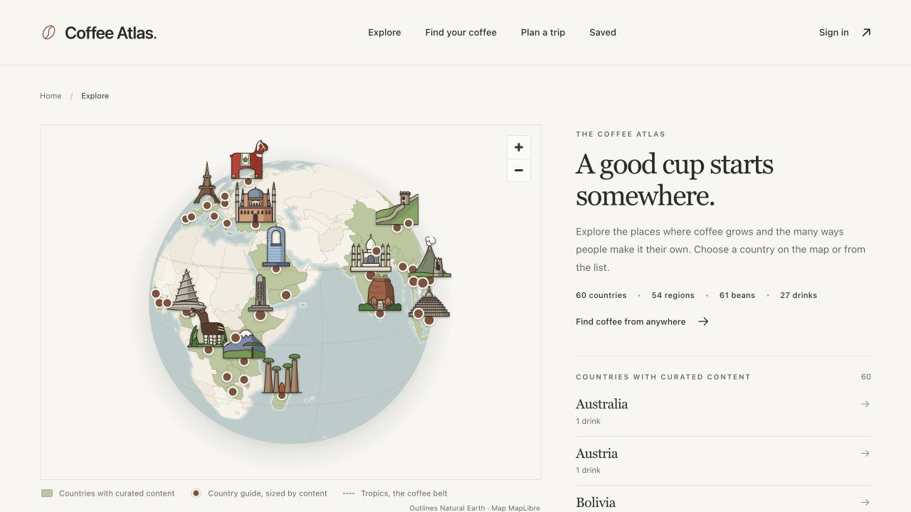
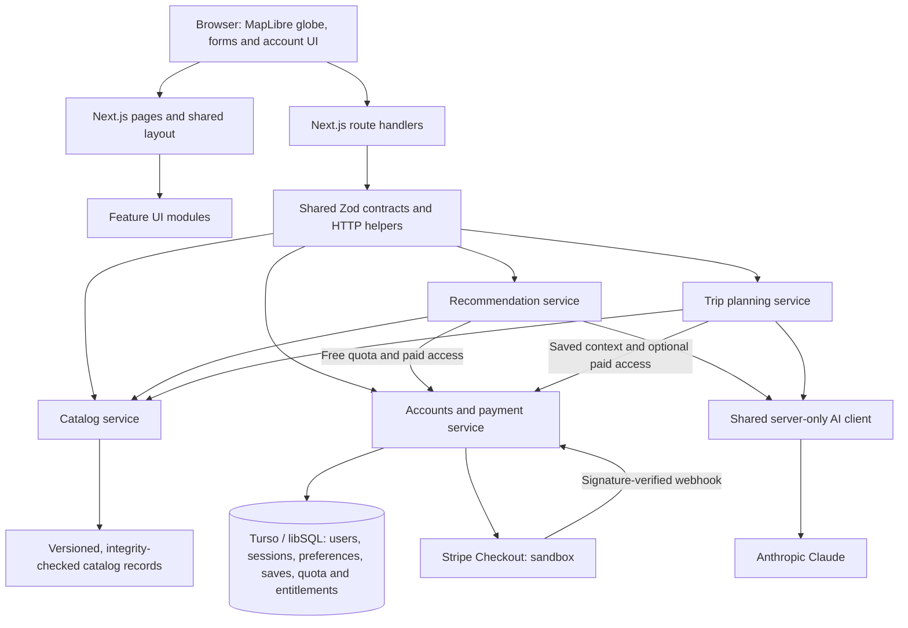

# Coffee Atlas

## Project participation

This was a collaborative group project, and I actively contributed to every stage of its development.

Original team repository: [HarryYuTou/Coffee_Atlas](https://github.com/HarryYuTou/Coffee_Atlas).

This repository contains a project snapshot for my portfolio. Original team documentation and acknowledgments are retained below.

Discover coffee beans and regional drinks through an interactive world map, personalized AI recommendations, and coffee-themed itineraries.

Coffee Atlas helps people who know what they like—fruity, chocolatey, creamy, or black—but are unsure what to try next. It connects everyday taste preferences to a sourced geographic catalog, with explanations that make unfamiliar coffees easier to explore.

**[Open the live app](https://coffee-atlas-phi.vercel.app)** · [Project write-up](writeup.md) · [Architecture](docs/ARCHITECTURE.md) · [Deployment guide](docs/DEPLOYMENT.md)



## Try the live app

The public application is hosted on **Vercel**, with persistent accounts on **Turso**, AI generation through **Anthropic**, and **Stripe sandbox** checkout. No local installation is needed.

1. Open [Explore](https://coffee-atlas-phi.vercel.app/explore), choose a country or region, and visit a bean or drink detail page.
2. [Create an account](https://coffee-atlas-phi.vercel.app/signup) to save discoveries and keep your taste preferences.
3. Open [Find your coffee](https://coffee-atlas-phi.vercel.app/recommendations), choose preferences, click **Save these preferences**, then **Find my coffee**. Results include reasons, source links, and links to the catalog.
4. Open [Plan a trip](https://coffee-atlas-phi.vercel.app/trip) to generate a coffee-discovery itinerary, optionally using your saved items.
5. Visit [Saved](https://coffee-atlas-phi.vercel.app/saved) to revisit favorites, or [your account](https://coffee-atlas-phi.vercel.app/account) to view preferences and recommendation access.

Each account starts with **three free successful AI recommendations**. A one-time **USD $5.00 test payment** on the [upgrade page](https://coffee-atlas-phi.vercel.app/upgrade) unlocks unlimited recommendations. Use Stripe's test card `4242 4242 4242 4242`, any future expiry date, and a three-digit CVC. No real funds move. You can try checkout before using all three free recommendations.

Trip planning is currently available without the paid unlock and does not consume recommendation credits. Itineraries are for coffee discovery; the app does not book travel or calculate transport schedules.

## What you can do

| Feature | Experience |
|---|---|
| Explore the globe | Browse countries and regions, then open linked coffee bean and regional drink pages. |
| Learn from sourced content | Discover origins, preparations, and pairings, with source links and clear distinctions between documented traditions and suggested combinations. |
| Get personalized recommendations | Describe taste, roast, milk, preparation methods, and free-text preferences; receive catalog-based suggestions with reasons and trade-offs. |
| Plan a coffee trip | Generate a 2–6-stop itinerary with numbered globe pins, route lines, recommendations, and detail links. |
| Keep a personal collection | Register, sign in, save beans and drinks, and retain preferences across sessions. |
| Try a paid product flow | Use free recommendation credits, complete Stripe test checkout, and retain unlimited access after signing in again. |

The curated catalog contains **60 countries, 54 regions, 61 beans, 27 drinks, 33 pairings, and 135 sources**. Catalog integrity checks keep geographic relationships and references consistent.

## Architecture

Coffee Atlas runs as one Next.js application. Pages and API routes delegate to feature modules, while shared contracts keep inputs and outputs consistent.



| Layer | Technology |
|---|---|
| Application | Next.js App Router, React, TypeScript, CSS |
| Maps | MapLibre GL and bundled geographic data |
| Validation | Shared Zod schemas and catalog integrity checks |
| Personal data | libSQL client with SQLite locally and Turso in production |
| AI | Anthropic SDK through a shared server-only client |
| Payments | Stripe Checkout and signature-verified webhooks in test mode |
| Delivery and checks | Vercel, GitHub Actions, Vitest, Biome |

The main design choices are:

- **Reviewed content, persistent personal data.** Catalog records live in Git for editorial review; accounts, preferences, saved items, usage, and entitlements live in the database.
- **AI constrained by the catalog.** The server selects eligible candidates and validates returned IDs, geography where relevant, duplicates, and reasons. Invalid output receives one corrective retry before an error is returned. Source links come from trusted catalog records.
- **Server-enforced access.** Sessions identify users and scope their data. Only a verified Stripe webhook grants paid access; a checkout redirect alone does not. Successful recommendation credits are claimed atomically.
- **Shared modules and contracts.** Both AI features use the same model client, account services, and runtime schemas, reducing duplicated behavior. Secrets remain on the server.

See [Architecture and design decisions](docs/ARCHITECTURE.md) for the full design rationale and implementation boundaries.

### Repository layout

```text
src/
  app/                 Pages, layouts, and API routes
  components/          Shared interface components
  contracts/           Zod schemas and shared types
  lib/server/          Service registry, HTTP helpers, and AI client
  modules/
    map-experience/    Globe exploration and item details
    catalog/           Curated records, filtering, and integrity checks
    accounts/          Authentication, persistence, quota, and payments
    recommendations/   Preference matching and recommendation UI
    trip-map/          Itinerary generation and trip globe
public/                Static assets and map data
tests/                 Automated tests
scripts/               Production smoke checks
docs/                  Architecture, deployment, and API documentation
writeup.md             Problem, solution, architecture, and next steps
```

## Run locally

Use **Node.js 22.12+ within the 22.x release line, or Node.js 24.x/26.x**, and npm. The included `.nvmrc` selects Node.js 22.

```sh
git clone https://github.com/HarryYuTou/440_Final_Project.git
cd 440_Final_Project
npm ci
cp .env.example .env.local
```

The map and catalog work without provider credentials. To enable accounts and AI locally, edit `.env.local`:

| Variable | Local configuration |
|---|---|
| `DATABASE_URL` | Keep `file:./data/coffee-atlas.db` for local SQLite. |
| `AUTH_SECRET` | Set a random secret of at least 32 characters. Generate one with `openssl rand -hex 32` and paste its output. |
| `MODEL_API_KEY` | Your Anthropic API key, used by recommendations and trips. |
| `MODEL_NAME` | Optional model override; leave blank to use the application's default. |
| `APP_URL` | Keep `http://localhost:3000` for local checkout return URLs. |

The database file and tables are created on first use. Without the relevant configuration, account, AI, and payment features display an unavailable message. Keep actual credentials in `.env.local`, which is excluded from Git.

Start the development server:

```sh
npm run dev
```

Open [localhost:3000](http://localhost:3000). Restart the server after changing environment variables.

### Optional local payment testing

Create a one-time price in a Stripe sandbox and set `STRIPE_SECRET_KEY` and `STRIPE_PRICE_ID`. With the Stripe CLI installed and authenticated, forward test events to the app:

```sh
stripe listen --forward-to localhost:3000/api/webhooks/stripe
```

Copy the listener's signing secret into `STRIPE_WEBHOOK_SECRET`, restart the app, and keep the listener running during checkout. The application accepts test-mode Stripe keys only. See the [account and payment documentation](src/modules/accounts/README.md) for event handling details.

For a local production build:

```sh
npm run build
npm start
```

## Deploy online

The live project uses **GitHub → Vercel** for deployment and **Turso** for persistent user data. Pushes or merges into `main` trigger a Vercel build; successful deployments update [coffee-atlas-phi.vercel.app](https://coffee-atlas-phi.vercel.app). GitHub Actions separately runs the verification suite on pull requests and pushes to `main`.

To recreate the deployment:

1. Create a Turso database and import the repository into Vercel as a Next.js project.
2. Set Vercel's Production environment variables from [`.env.example`](.env.example): use the Turso URL and token for `DATABASE_URL` and `DATABASE_AUTH_TOKEN`, generate `AUTH_SECRET`, set `APP_URL` to your public HTTPS URL, and add `MODEL_API_KEY`. Hosted user data belongs in Turso; the local SQLite file is for development.
3. Create a Stripe sandbox product with a one-time price and configure `STRIPE_SECRET_KEY` and `STRIPE_PRICE_ID`.
4. Deploy, then create a Stripe **snapshot** webhook destination at `https://YOUR_DOMAIN/api/webhooks/stripe` for `checkout.session.completed`, `checkout.session.async_payment_succeeded`, `checkout.session.async_payment_failed`, and `checkout.session.expired`. Save its signing secret as `STRIPE_WEBHOOK_SECRET` and redeploy so the new setting takes effect.
5. Check `/api/health`, then complete signup, preference saving, recommendation and trip generation, test checkout, and logout/login on the public site. Health confirms configuration presence; the walkthrough checks that the integrations work together.

Leave `ENABLE_DEV_FIXTURES` disabled in production. By default, trips are outside the payment gate; set `TRIP_REQUIRES_ACCESS=true` to include them in the same one-time unlock. Trips never consume recommendation credits.

The [deployment guide](docs/DEPLOYMENT.md) contains the full environment reference, webhook configuration, and recorded live acceptance results.

## Testing

Run the full verification sequence:

```sh
npm run verify
```

This runs TypeScript checks, lint, automated tests, a production build, and smoke checks against the built application. Coverage includes catalog integrity, account isolation and persistence, recommendation quotas, invalid AI output and retries, payment signatures and duplicate events, and trip access behavior. AI service tests use controlled model responses. Production smoke checks use fresh local databases with external credentials disabled; neither makes live AI calls or charges money.

For a faster check during development, use `npm run check`. To run only the production smoke checks, run `npm run test:smoke` after a successful build.

The public-site walkthrough has also been completed, including both AI features, Stripe sandbox payment, and persistence after re-login. Detailed evidence and the distinction between automated checks and manual acceptance are recorded in the [deployment guide](docs/DEPLOYMENT.md). Systematic recommendation-quality and performance evaluation remain future work.

## Further reading

- [Project write-up](writeup.md): problem, scoped product requirements, solution, architecture, and next steps.
- [Architecture](docs/ARCHITECTURE.md): system relationships, module boundaries, and design decisions.
- [Deployment](docs/DEPLOYMENT.md): hosting, service configuration, and live acceptance evidence.
- [Contracts and API routes](docs/CONTRACTS.md): shared request and response definitions.
- [Catalog](src/modules/catalog/README.md): content model, sources, and integrity rules.
- [Accounts and payments](src/modules/accounts/README.md): authentication, persistence, quotas, and Stripe behavior.
- [Recommendations](src/modules/recommendations/README.md) and [trip planning](src/modules/trip-map/README.md): AI implementation and feature evidence.
