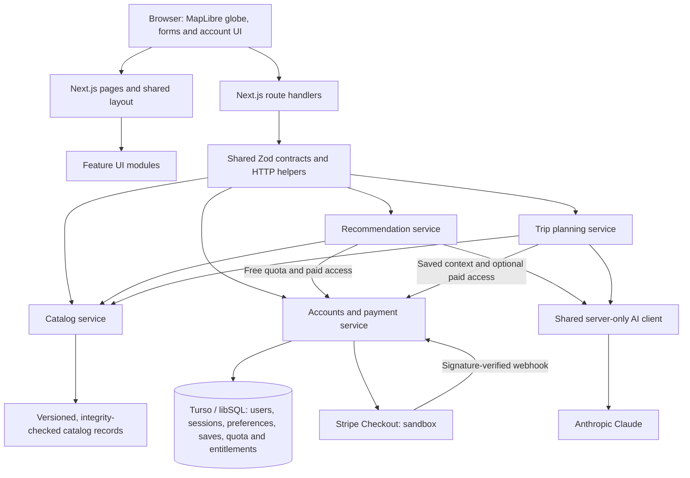

# Coffee Atlas Architecture

## Implemented system

Coffee Atlas is one Next.js App Router application using React, TypeScript, plain CSS, and npm. The merged application includes geographic discovery, accounts, saved items, AI recommendations, an AI trip map, and Stripe test payments. It runs on Vercel at [coffee-atlas-phi.vercel.app](https://coffee-atlas-phi.vercel.app), with Turso for persistent user data and Anthropic for both AI features. GitHub `main` is connected to automatic production deployment.

All connections shown are implemented. Local development uses a SQLite file through the same libSQL interface; hosted accounts use Turso. Provider credentials stay on the server. Missing configuration produces structured errors rather than successful placeholder results. Development fixtures require both `NODE_ENV=development` and `ENABLE_DEV_FIXTURES=true`; production rejects the fixture endpoint.

## Repository organization

| Path | Purpose |
|---|---|
| `src/app/` | Page entry points, shared layout, CSS, and API routes |
| `src/components/` | Shared interface components |
| `src/contracts/` | Shared schemas and types for catalog, accounts, preferences, saves, recommendations, trips, and access |
| `src/lib/server/` | HTTP/validation helpers, service registry, and shared Anthropic client |
| `src/modules/map-experience/` | Globe exploration and item-detail UI, shared map support |
| `src/modules/catalog/` | Versioned records, integrity checks, filtering, and catalog service |
| `src/modules/accounts/` | Authentication, persistence, quota, checkout, entitlements, and shared save UI |
| `src/modules/recommendations/` | Preference form, candidate selection, model prompt, output validation, and recommendation service |
| `src/modules/trip-map/` | Trip form and globe, destination selection, model prompt, route validation, and trip service |
| `src/dev/` | Explicit development examples, never a production catalog or identity source |

## Design decisions

- **One application with feature boundaries.** Pages and API routes delegate to modules through a central service registry. Shared Zod contracts validate data across HTTP and provider boundaries, complementing TypeScript and supporting parallel feature development.
- **Catalog in Git, users in a database.** The catalog contains 60 countries, 54 regions, 61 beans, 27 drinks, 33 pairings, and 135 sources. Schema and integrity checks reject duplicate IDs and broken references. Personal records store catalog IDs; Turso persists accounts, preferences, saves, quota, and entitlements. The database schema is created on first use.
- **Distinct geographic relationships.** Bean-growing origin, drink cultural association, and bean–drink pairing remain separate concepts. Suggested combinations are labeled separately from documented traditions; unknown attributes stay empty rather than being invented.
- **Server-controlled identity and access.** Passwords use scrypt; random session tokens are stored as HMACs and sent in `HttpOnly` cookies, with `Secure` on HTTPS. Account writes reject cross-site origins, queries are scoped to the signed-in user, and repeated failed logins trigger a temporary block.
- **A scoped payment model.** Each account receives three successful free AI recommendations, then a one-time USD $5.00 Stripe sandbox unlock for unlimited recommendations. Only verified webhooks grant access; checkout redirects do not. Event processing is idempotent. A final atomic quota claim prevents concurrent requests from delivering more than the free allowance. Trips do not spend recommendation credits and are currently outside the payment gate; `TRIP_REQUIRES_ACCESS=true` makes them use the same entitlement.
- **Catalog-grounded AI.** Both features use the shared Anthropic client. Code selects eligible items or destinations before calling the model, then checks returned IDs, uniqueness, geography where relevant, and nonempty reasons. Recommendation sources are restricted to allowed catalog references; trip sources come directly from catalog records. Each service retries an invalid answer once before returning an error. The trip service reads saved preferences and items through the account service. These checks validate structure and references, not the truth of every generated sentence or subjective taste match.
- **Usable geographic fallback.** MapLibre renders the globe and trip connections. Trip cards remain usable when coordinates or WebGL are unavailable. Itineraries support coffee discovery; they do not provide bookings, verified café availability, or optimized transport schedules.

## Deployment and evidence

Vercel hosts the application, Turso persists account data, Anthropic provides AI generation, and Stripe provides sandbox Checkout and signed webhooks. Environment variables configure integrations without exposing credentials to the browser. See [deployment and acceptance evidence](DEPLOYMENT.md) for operational details, [the project write-up](../writeup.md) for the product rationale, and feature module reports for implementation evidence.
